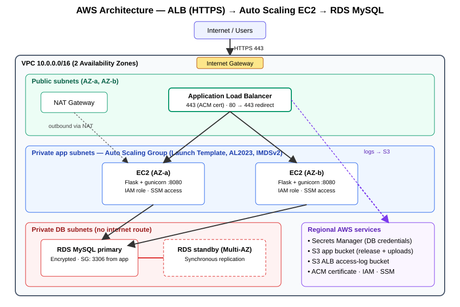

# DevOps Practical – AWS Infrastructure & CI/CD (Terraform)

Complete AWS stack defined as code, deployed through GitHub Actions.

```
Internet → ALB (HTTPS, ACM) → Auto Scaling EC2 (private) → RDS MySQL (private)
                 └→ S3 (access logs)
```



## Repository layout

| Path | Purpose |
|---|---|
| `app/` | Flask sample app (`/`, `/health`, `/db`) |
| `terraform/` | All infrastructure (network, security, IAM, secrets, RDS, S3, ALB, ASG) |
| `.github/workflows/terraform.yml` | Validate → Plan → Apply (+ health checks) / Destroy |
| `docs/DEPLOYMENT.md` | Step-by-step deployment and validation guide |
| `docs/architecture.svg` | Architecture diagram |
| `docs/screenshots/` | Place deployment screenshots here (checklist inside) |

## What is built

- **Networking:** VPC, 2 public / 2 private-app / 2 private-DB subnets across 2 AZs, Internet Gateway, NAT Gateway, separate route tables (DB subnets have no internet route).
- **Compute:** Launch Template (Amazon Linux 2023, IMDSv2 only, encrypted EBS) + Auto Scaling Group (min 2, CPU target-tracking, ELB health checks, rolling instance refresh on app changes).
- **Load balancing:** Internet-facing ALB, HTTPS listener (TLS 1.3 policy), HTTP→HTTPS redirect, access logs to S3.
- **Database:** RDS MySQL 8.0 in private subnets, encrypted at rest, Multi-AZ, automated backups.
- **Secrets:** random password stored in AWS Secrets Manager; the app reads it at runtime via its IAM role. No credentials in code, user data or CI.
- **IAM / SGs:** least-privilege instance role (one secret, specific S3 prefixes, SSM). Security groups chain ALB → app (8080) → DB (3306) by SG reference; no SSH, access via Session Manager.
- **S3:** app bucket (release artifacts, `uploads/`) and ALB-log bucket; both encrypted, versioned/lifecycle-managed, public access blocked, TLS-only policies.
- **CI/CD:** GitHub Actions with OIDC (no long-lived AWS keys), fmt/validate/lint, plan artifact, gated apply, automated `/health` and `/db` checks.

## HTTPS and domains

- `domain_name = ""` (default): Terraform imports a **self-signed certificate into ACM** so HTTPS works end to end on the ALB DNS name. Browsers will warn; use `curl -k` for checks.
- Set `domain_name` (and optionally `route53_zone_id`) once you own a domain: Terraform requests a real, DNS-validated ACM certificate and, with a Route 53 zone, creates the validation and alias records. Without a Route 53 zone, create the CNAMEs from the `acm_validation_records` output at your DNS provider.

## Quick start

```bash
cd terraform
cp terraform.tfvars.example terraform.tfvars
terraform init -backend=false     # or: terraform init -backend-config=backend.hcl
terraform plan
terraform apply
terraform output application_url
```

See [`docs/DEPLOYMENT.md`](docs/DEPLOYMENT.md) for the CI/CD setup and validation steps.

## Cost note

NAT Gateway, ALB and Multi-AZ RDS bill hourly. Run `terraform destroy` (or the workflow's *destroy* input) when you are finished.
